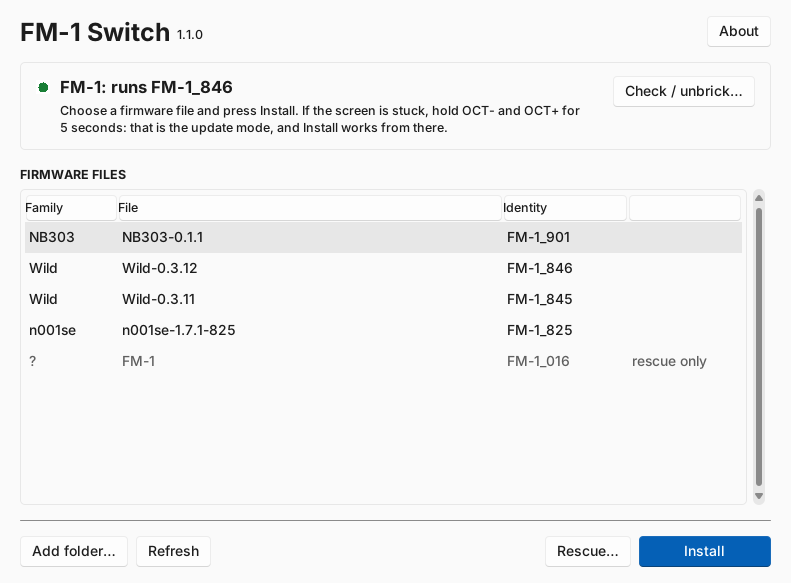

# FM-1 Switch

> **Everything you do with FM-1 Switch is at your own risk.** Installing or rescuing firmware can
> leave your FM-1 unusable for good. There is no warranty, and neither Noisebud nor the author nor any
> contributor is responsible for anything that happens. See [DISCLAIMER.md](DISCLAIMER.md).

A small window for the M-VAVE FM-1 that installs any FM-1 firmware file (`.fwsc`), in either
direction and whatever its number, and that checks and rescues an FM-1 that seems bricked. It runs
on Windows and on the Mac.

M-VAVE's M-UPGRADE only takes a firmware with a higher number than the one installed. FM-1 Switch
takes any Felucca-based package for the FM-1 model, such as Wild, NB303, n001se or FiMba-1, so you
can go from one to the other and back.

<picture>
  <source media="(prefers-color-scheme: dark)" srcset="docs/screenshot-dark.png">
  
</picture>

It follows the system's dark or light mode (Windows 11's own look, through
[sv-ttk](https://github.com/rdbende/Sun-Valley-ttk-theme)).

## Use

1. Put `FM1-Switch.exe` (Windows) or `FM1-Switch.app` (Mac) in a folder. It lists the `.fwsc` files
   in its own folder, in `Firmware Wild`, `Firmware NB303`, `Firmware n001se` and `Firmware
   Original` beside it, and in Downloads. **Add folder…** adds more. The highest number is listed
   first.
2. Connect the FM-1 with a USB data cable, straight into the computer, and close other MIDI apps.
3. Choose a file and press **Install**. Do not unplug the FM-1 while it writes.

## A bricked FM-1

Press **Check / unbrick…**. A guide takes you through it in three steps:

1. **It listens to the FM-1** for a few seconds, in every mode it can be in. When the FM-1 answers,
   that decides what to do, with no questions:

   | It finds | What it means | The button |
   |---|---|---|
   | runs FM-1_N | the firmware answers (also in Wild's safe mode): not bricked | Install |
   | in update mode | an install was cut off, and the FM-1 waits for it | Finish the install |
   | the chip's own update mode | the firmware does not start (UBOOT, USB 4C4A:8057) | Try to unbrick |

2. **It asks**, only when nothing answers: what the screen shows (its usual picture, SAFE MODE,
   UPDATE MODE, dark, or restarting over and over) and what happened last. It keeps listening while
   you answer, and if the FM-1 turns up, the guide goes on by itself.
3. **It gives you one thing to try**, step by step, behind one button:
   - A picture, SAFE MODE or UPDATE MODE means the FM-1 runs but the computer does not hear it. The
     guide goes through the cable (a data cable, no hub), the port and apps holding the MIDI port,
     then **Check again**.
   - A dark screen means: charge it first, because a flat battery looks the same. Then **Try to
     unbrick**.
   - Restarting over and over means **Try to unbrick**. A firmware that keeps crashing reaches the
     chip's own update mode by itself, and the rescue catches it there.
   - If a rescue never catches it, the guide explains the
     [FM-1-transporter](https://github.com/kurogedelic/FM-1-transporter), an RP2040 board wired to
     the USB lines that wakes the chip's update mode from outside.

**Try to unbrick** (also the **Rescue…** button) puts a firmware back through the chip's own update
mode, with no extra hardware. First you **choose the firmware**: M-VAVE's V15 is chosen at the top,
because it is what the FM-1 came with. Any other FM-1 firmware works too: anything in the list, or
any file with **Browse…** (Wild, NB303, n001se, FiMba-1, another M-VAVE version, other people's
firmware). Then you **tick that it is at your own risk**, and it starts:

- For V15, it finds the file among your `.fwsc` files by its SHA-256, whatever the file is called. If it is not
  there, it downloads V15 from M-VAVE's server and checks it. It also downloads JieLi's flash loader
  (`wl82loader.bin`, from [jl-uboot-tool](https://github.com/kagaimiq/jl-uboot-tool)) and checks
  that. Both are kept in `FM-1 Rescue` beside the program.
- It needs an administrator on Windows (Windows asks) or your password on the Mac, so that it can
  take the FM-1 away from the system.
- It saves the whole flash (1 MiB) in `FM-1 Rescue` before anything else.
- It writes only the parts of the firmware area (0x4000–0x93000) that differ from the chosen
  firmware. The chip's boot code below 0x4000 and the device data above 0x93000 are never written,
  so the FM-1 keeps its own boot part, the same way an ordinary update does. Nothing is written if
  the chip and its flash are not the FM-1's, or if the firmware's app area does not decrypt with this
  chip's key (a firmware for another chip). For V15, the boot part must also already be V15's.
- A firmware that is neither V15 nor Felucca-based may not fall back to the chip's update mode by
  itself if it fails to start. The next rescue could then need the adapter.
- **Stop** gives up while it waits. A write that has begun is finished.

After a rescue to V15, you can install Wild, NB303 or another firmware as usual.

**Experimental: through an FM-1-transporter.** An FM-1 that shows nothing at all on USB can't reach
the chip's update mode by itself. An [FM-1-transporter](https://github.com/kurogedelic/FM-1-transporter)
is an RP2040 board (a Seeed XIAO RP2040) wired to the FM-1's USB lines with three wires: D+, D− and
GND, never 5 V. It wakes that mode from outside at power-on. When a rescue never sees the FM-1, the
guide offers **Try with the adapter (experimental)**. That runs the same rescue through the adapter's
serial port, with the same checks, and the adapter's own firmware also refuses anything outside
0x4000–0x93000. It needs no administrator. If the FM-1 runs no firmware, switch it off when the app
says so, then on. **This has not been tried on an FM-1 from this app yet.**

On Windows it talks to the FM-1 through the Windows disk driver (SCSI pass-through), so no driver
has to be installed. On the Mac it uses libusb, which is bundled in the app. The protocol and the
write policy are FM-1-transporter's, which were verified on hardware. **The Windows path has not
been tried on an FM-1 yet.**

Installing firmware is at your own risk.

## Build

Windows: `tools/build_switch_exe.bat` (Python 3 from python.org) makes `tools/dist/FM1-Switch.exe`.
CI also builds it on every push, under the Actions run's artifacts (FM1-Switch-windows).

Mac, the same way as the Noisebud apps: `tools/export_switch_mac.cmd` on the PC puts
`FM1Switch_mac_ready_vX.zip` and `Build_FM1Switch_Mac.command` in the Mac Export folder that syncs to
the Mac. Double-click the `.command` there. It runs `tools/build_switch_mac.sh`, which makes a
universal `FM1-Switch.app` and `FM1Switch_macOS_vX.dmg`. `NOISEBUD_APPLE_SIGN_IDENTITY` and
`NOISEBUD_APPLE_NOTARY_PROFILE` sign and notarize it. Without them the app is unsigned: the first
time, right-click it and choose Open.

From source: `pip install -r requirements.txt`, then `python tools/fm1_switch.pyw` (without the MIDI
packages the window says so instead of looking for the FM-1). The parts also
work on their own from the command line:

```
python3 tools/fm1_install.py PACKAGE.fwsc        # install over USB-MIDI
python3 tools/fm1_install.py --info              # what the FM-1 runs
sudo python3 tools/fm1_rescue.py FM-1.fwsc       # Mac/Linux: check and back up, write nothing
sudo python3 tools/fm1_rescue.py FM-1.fwsc --write
python tools/fm1_rescue.py --download --write    # Windows, as administrator (V15 from M-VAVE)
python tools/fm1_rescue.py Wild.fwsc --any-firmware --write              # another firmware
python tools/fm1_rescue.py FM-1.fwsc --via transporter --write           # EXPERIMENTAL: the adapter
```

## Tests

`tests/run_tests.sh` (or each `python tests/*_test.py`) runs everything against a simulated FM-1,
with no hardware, no Tk and no MIDI or USB packages:

- `install_test.py`: the USB-MIDI update.
- `switch_test.py`: the window's core, the diagnosis and the command that Rescue runs as
  administrator or root.
- `rescue_test.py`: the rescue against a simulated UBOOT (the ROM and JieLi's loader at the level of
  their commands), over USB, over a simulated Windows pass-through and over a simulated
  FM-1-transporter. It covers any firmware with the FM-1's head kept, and refuses one for another
  chip key.

CI runs them on Linux, Windows and macOS.

## Credits and licence

GPL-3.0 (see `LICENSE`), with no warranty and no liability (its sections 15 and 16, and
[DISCLAIMER.md](DISCLAIMER.md)). The installer is Felucca's (`fm1_install.py`, Leo Kuroshita / Hügelton
Instruments). The rescue protocol and write policy come from
[FM-1-transporter](https://github.com/kurogedelic/FM-1-transporter) (MIT) and the X0X firmware's
`fm1_rescue.py`. The adapter support speaks FM-1-transporter's `fm1t` protocol. The flash loader is from [jl-uboot-tool](https://github.com/kagaimiq/jl-uboot-tool)
(MIT). It is downloaded, not included. Not affiliated with M-VAVE or JieLi.
